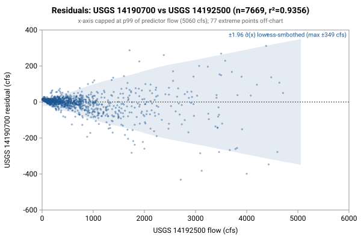

# Linear regression: USGS 14190700 from 14192500

**Goal**: estimate USGS `14190700` from `14192500` so a downstream `calc_expression` can replace the target gauge.



Generated by:

```bash
python3 scripts/regression/gauge_pair_linear.py \
    --predictor 14192500 \
    --target 14190700 \
    --start 1957-10-01 \
    --end 1978-09-29 \
    --name rickreall_14190700_from_syamhill \
    --calc-handle sy::WLAO3
```

## Data

All series are USGS daily-mean flow (`parameterCd=00060`, `statCd=00003`).

| Gauge | Period of record | Daily means |
|---|---|---|
| `14190700` (target) | 1957-10-01 → **1978-09-29** | 7669 |
| `14192500` (predictor) | 1934-05-01 → 1993-09-29 | 21702 |
| **Overlap (full)** | 1957-10-01 → 1978-09-29 | **7669** |

Note: USGS records can be **non-contiguous** (instrumentation outages).
The chosen window is selected for *data points*, not calendar span.

## Chosen fit

Window: **1957-10-01 → 1978-09-29**, n = **7669** daily means (~21.0 years of data).

### Coefficients (with honest, autocorrelation-aware uncertainty)

Daily streamflow residuals are strongly autocorrelated (lag-1 **0.56** here), which violates the IID assumption behind the OLS standard errors — so **SE (OLS)** is optimistic. **SE (block-boot)** resamples whole monthly blocks (252 months, B=1000), preserving the serial correlation; it is the realistic figure and runs about **7.1x** the OLS SE. The **95% CI** below is the block-bootstrap percentile interval. **VIF** is the variance-inflation factor (collinearity with the other predictors); VIF > 10 means the individual coefficient is poorly determined and should not be read as a physical sensitivity.

| Term | Estimate | SE (OLS) | SE (block-boot) | 95% CI (block-boot) | VIF |
|---|---|---|---|---|---|
| intercept | -13.9651 | 0.9151 | 2.593 | [-19.1, -8.992] | — |
| sy::WLAO3 (predictor 1: 14192500) | +0.247117 | 0.0007407 | 0.005238 | [+0.2366, +0.2572] | 1.0 |

r² = **0.9356**, RMSE = **68.42 cfs** (sigma_hat = 68.43 cfs unbiased).

Predictor / target summary:

| Series | Mean | Range |
|---|---|---|
| target `14190700` | 144.95 | [0, 5650] |
| predictor `14192500` | 643.09 | [4, 16400] |

### Parameter covariance

Full variance-covariance matrix (rows/cols in `coef_names` order):

```
                intercept            x1
   intercept  +8.3749e-01  -3.5286e-04
          x1  -3.5286e-04  +5.4870e-07
```

Correlation matrix:

```
              intercept          x1
   intercept  +1.0000      -0.5205
          x1  -0.5205      +1.0000
```

**Caveat 1 (autocorrelation)**: this is the **OLS** covariance, which assumes IID residuals; with lag-1 residual autocorrelation **0.56** it understates the parameter SE by roughly **7.1x**. Use the block-bootstrap SEs/CIs in the coefficients table for inference, not these (monthly blocks; longer blocks would only widen the intervals, so they are conservative for the most autocorrelated fits).

**Caveat 2 (prediction vs parameter)**: even with correct parameter SEs, a single-day prediction at new `x` is dominated by the residual scatter `sigma_hat` (about 68 cfs at 1-sigma here), not by parameter uncertainty. `sigma_hat` is a valid *marginal* description of single-day error (autocorrelation barely biases it); what autocorrelation breaks is treating the n days as n independent observations.

## Window stability

Re-fit at multiple start dates (endpoint fixed at `1978-09-29`):

| Window start | n | data yr | slope | intercept | r² | RMSE | SE(slope) | SE(int) |
|---|---|---|---|---|---|---|---|---|
| 1952-10-02 | 7669 | 21.0 | 0.2471 | -13.97 | 0.9356 | 68.4 | 0.0007 | 0.92 |
| 1957-10-01 | 7669 | 21.0 | 0.2471 | -13.97 | 0.9356 | 68.4 | 0.0007 | 0.92 |
| 1962-09-30 | 5844 | 16.0 | 0.2494 | -14.86 | 0.9341 | 72.6 | 0.0009 | 1.10 |
| 1967-09-29 | 4019 | 11.0 | 0.2483 | -13.81 | 0.9332 | 71.4 | 0.0010 | 1.32 |
| 1972-09-27 | 2194 | 6.0 | 0.2622 | -18.12 | 0.9427 | 67.3 | 0.0014 | 1.67 |

## Residual diagnostics

**Percentile distribution** (residual = y - y_hat, cfs):

| p01 | p05 | p25 | p50 | p75 | p95 | p99 |
|---|---|---|---|---|---|---|
| -216.8 | -81.7 | -8.0 | +9.0 | +14.0 | +47.0 | +171.9 |

**By predictor-1 quintile** (Q1 = lowest values of `14192500`):

| Quintile | x median | mean residual | std residual | n |
|---|---|---|---|---|
| Q1 | 20 | +13.1 | 2.4 | 1533 |
| Q2 | 72 | +8.9 | 7.1 | 1533 |
| Q3 | 251 | +4.4 | 18.5 | 1533 |
| Q4 | 625 | -5.5 | 35.0 | 1533 |
| Q5 | 1730 | -20.7 | 145.0 | 1537 |

### By hydrologic season

Residuals bucketed by monsoonal season (most kayak gauges sit in a PNW monsoonal regime). **Mean / median flow** give each season's target-flow magnitude. **Bias** is the mean residual (y - y_hat); a non-zero bias means the pooled fit systematically over- (negative) or under-predicts (positive) in that season. **% of flow** normalizes the bias by the season's mean flow so it's comparable across gauges. The remaining columns (median residual, std, RMSE) are residual statistics in cfs.

| Season | n | mean flow | median flow | bias (cfs) | % of flow | median resid | std | RMSE |
|---|---|---|---|---|---|---|---|---|
| Heavy rain (Nov-Dec) | 1281 | 281 | 163 | -17.5 | -6.2% | -8.0 | 110.5 | 111.8 |
| Light rain (Jan-Feb) | 1244 | 344 | 217 | -2.4 | -0.7% | -1.1 | 109.2 | 109.2 |
| Rain-on-snow (Mar-Apr) | 1281 | 185 | 128 | -3.4 | -1.8% | +1.0 | 53.7 | 53.8 |
| Dry season (May-Oct) | 3863 | 23 | 9 | +7.7 | +34.2% | +11.1 | 17.1 | 18.8 |

A season whose bias is large relative to `sigma_hat` (the pooled 1-sigma residual scatter) is a candidate for a season-specific intercept or a separate seasonal fit; a season with elevated `std`/`RMSE` but near-zero bias is just noisier (e.g., flashy storm response), not mis-calibrated.

## Predictions at example x values

For each row, `y_hat` is the fitted value and the two CIs are 95% two-sided bands. The **mean-response CI** is the uncertainty in `E[y | x]` (use for plotting the fit line's confidence band). The **prediction CI** is for a *single new observation* — bounded below by `sigma_hat` regardless of how precisely the parameters are estimated.

| pred-1 position | x (14192500) | y_hat | 95% CI (mean resp.) | 95% CI (single obs.) |
|---|---|---|---|---|
| p05 (low) | 15 | -10.3 | [-12.0, -8.5] (±1.8) | [-144.4, 123.9] (±134.1) |
| p25 | 53 | -0.9 | [-2.6, 0.9] (±1.8) | [-135.0, 133.3] (±134.1) |
| p50 (median) | 251 | 48.1 | [46.4, 49.7] (±1.6) | [-86.1, 182.2] (±134.1) |
| p75 | 772 | 176.8 | [175.3, 178.4] (±1.5) | [42.7, 310.9] (±134.1) |
| p95 (high) | 2570 | 621.1 | [617.9, 624.3] (±3.2) | [487.0, 755.3] (±134.2) |

### Computing a CI at any other x*

All the information needed to compute prediction CIs at any new predictor value is in this document. With the design row `X* = [1, x1*, x2*, ...]` — plus a squared column for each predictor fitted quadratically, in predictor order — matching the column order in the covariance matrix above:

```
y_hat = X* . coefs
Var(mean response) = X* . Cov(beta) . X*'
Var(single observation) = Var(mean response) + sigma_hat^2
SE = sqrt(Var)
95% CI = y_hat +/- 1.96 * SE     (n >> 30, large-sample z; use t_{n-p} for small n)
```

For this single-predictor linear fit, the equivalent closed form is:

```
Var(mean response at x*) = sigma_hat^2 * (1/n + (x* - mean_x)^2 / Sxx)
                         where mean_x = 643.0852, sigma_hat = 68.4288,
                         n = 7669, Sxx = sigma_hat^2 / SE(slope)^2 = 8.5338e+09
```

## `calc_expression` row

`calc_expression` rows are **metadata**: add a row to `calc_expression.csv` in the `kayak_data` repo (stable `id` from `id_counters.csv`, `provenance_slug` = this report's slug) and let `levels sync-metadata` apply it on deploy. Do **not** put this in a migration — a new migration may not write a metadata table (`tests/test_scripts/test_migrations_schema_only.py`). The handles (`sy::WLAO3`) follow the `prefix::gauge_name` convention enforced by `kayak.cli.calculator._resolve_refs`. Column values:

```
data_type:       flow
expression:      round(greatest(0, 0.247117 * sy::WLAO3::flow -13.97))
time_expression: sy::WLAO3::flow
note:            linear regression fit. n=7669 daily means, window 1957-10-01..1978-09-29, r2=0.9356, RMSE=68.4 cfs. See regression/rickreall_14190700_from_syamhill.md.
provenance_slug: rickreall_14190700_from_syamhill
```

Flesh out `note` before committing — the strongest existing rows also record window stability, rejected predictors, and any drainage-area scaling (see `calc_expression.csv` for examples).

## Future

- **Piecewise-linear fit by predictor-1 quintile.** If the residual table above shows systematic mean drift across quintiles (e.g., consistently under-estimating at low flow and over-estimating at high flow), splitting the predictor range into 2-3 regimes and fitting one linear model per regime can halve RMSE without adding free parameters beyond what `calc_expression` already supports via `greatest(low_estimate, high_estimate)` or `if(x < threshold, ..., ...)`-style composition. Worth trying when RMSE > ~10% of the mean target value.
- **Re-running** when the active predictor's rating curve drifts. USGS occasionally updates stage-discharge ratings; the `Reproduce` snippet above re-pulls the full period of record on demand.
- **Sub-daily lead/lag.** This fit is on daily means, but the `calc_expression` applies its coefficients to the *latest instantaneous* predictor readings — so inter-gauge travel time (1-12 h) becomes a timing error the daily fit never sees. `gauge_lead_lag.py` (same directory) quantifies that error from USGS unit values; worth a look when predictors are many river-miles from the target. (Run it to embed a summary here via `--leadlag`.)
